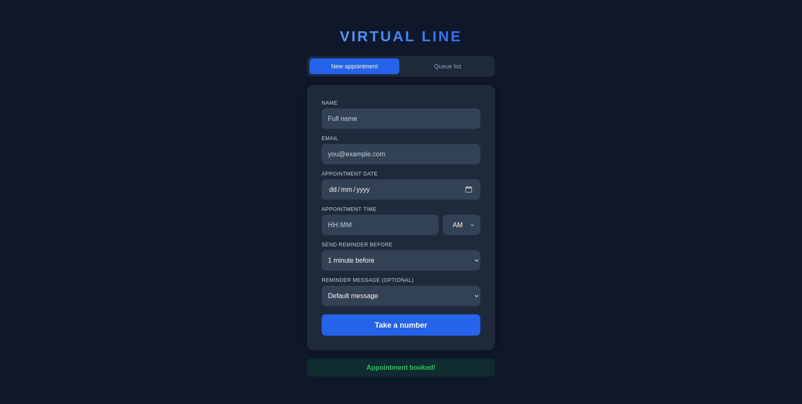
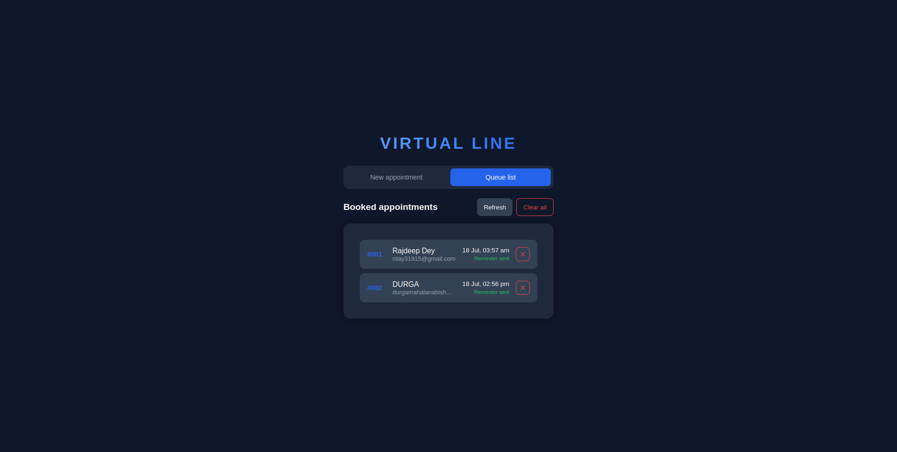
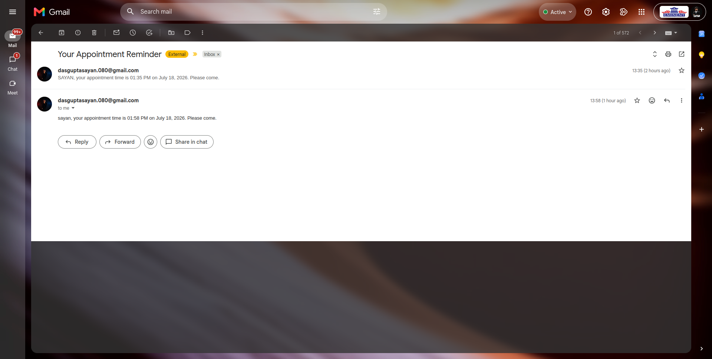

# 🚀 Virtual Line System

<p align="center">
  
</p>

<p align="center">
  <strong>A smart queue management system built with Flask and Firebase.</strong>
</p>

---

## 📖 Overview

**Virtual Line System** is a web-based queue management application that allows users to join a virtual queue instead of waiting in physical lines.

The system helps organizations reduce crowding, improve customer experience, and efficiently manage appointments or service queues.

---

## ✨ Features

- 🔐 Secure user registration & login
- 📋 Join virtual queue
- 🔢 Automatic token generation
- ⏳ Real-time queue status
- 📧 Email notification support
- ☁ Firebase database integration
- ⏰ Queue scheduler
- 📱 Responsive user interface
- 🎨 Modern design

---

## 🛠 Technology Stack

| Technology | Purpose |
|------------|---------|
| Python | Backend |
| Flask | Web Framework |
| Firebase | Database |
| HTML5 | Frontend |
| CSS3 | Styling |
| JavaScript | Client-side Logic |
| SMTP | Email Notifications |

---

## 📁 Project Structure

```
VERTUAL LINE SYSTEM/
│
├── app.py
├── config.py
├── firebase_service.py
├── email_service.py
├── scheduler.py
├── requirements.txt
│
├── static/
│   ├── logo.png
│   ├── css/
│   └── js/
│
├── templates/
│   └── index.html
│
└── README.md
```

---

## ⚙ Installation

### 1. Clone the Repository

```bash
git clone https://github.com/sayan08880/VERTUAL-LINE-SYSTEM.git
```

### 2. Go to Project Folder

```bash
cd "VERTUAL LINE SYSTEM"
```

### 3. Create Virtual Environment

Linux/Mac

```bash
python3 -m venv venv
source venv/bin/activate
```

Windows

```cmd
python -m venv venv
venv\Scripts\activate
```

### 4. Install Dependencies

```bash
pip install -r requirements.txt
```

### 5. Configure Firebase

Place your Firebase Service Account Key in the project directory.

```
serviceAccountKey.json
```

Update your Firebase configuration if required.

---

## ▶ Run the Application

```bash
python app.py
```

Open your browser:

```
http://127.0.0.1:5000
```

---

## 📧 Email Configuration

Configure your email credentials inside:

```
config.py
```

or

```
.env
```

depending on your setup.

---

## 📸 Screenshots









---

## 📌 Future Improvements

- Admin Dashboard
- SMS Notifications
- QR Code Token
- Multi-Branch Queue
- Appointment Booking
- Analytics Dashboard
- User History
- Dark Mode

---

## 👨‍💻 Author

**Sayan Mahalanabish**

BCA Student

---

## 📜 License

This project is created for educational and learning purposes.

---

## ❤️ Acknowledgements

- Flask
- Firebase
- Python Community
- Open Source Contributors

---

<p align="center">
Made with ❤️ using Flask & Firebase
</p>
